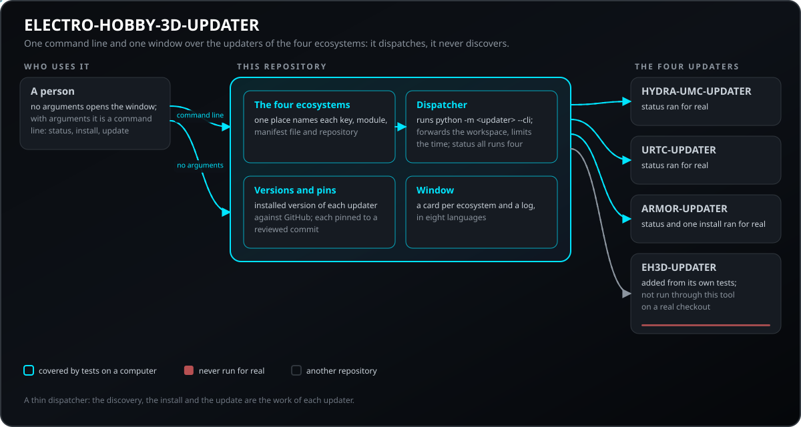
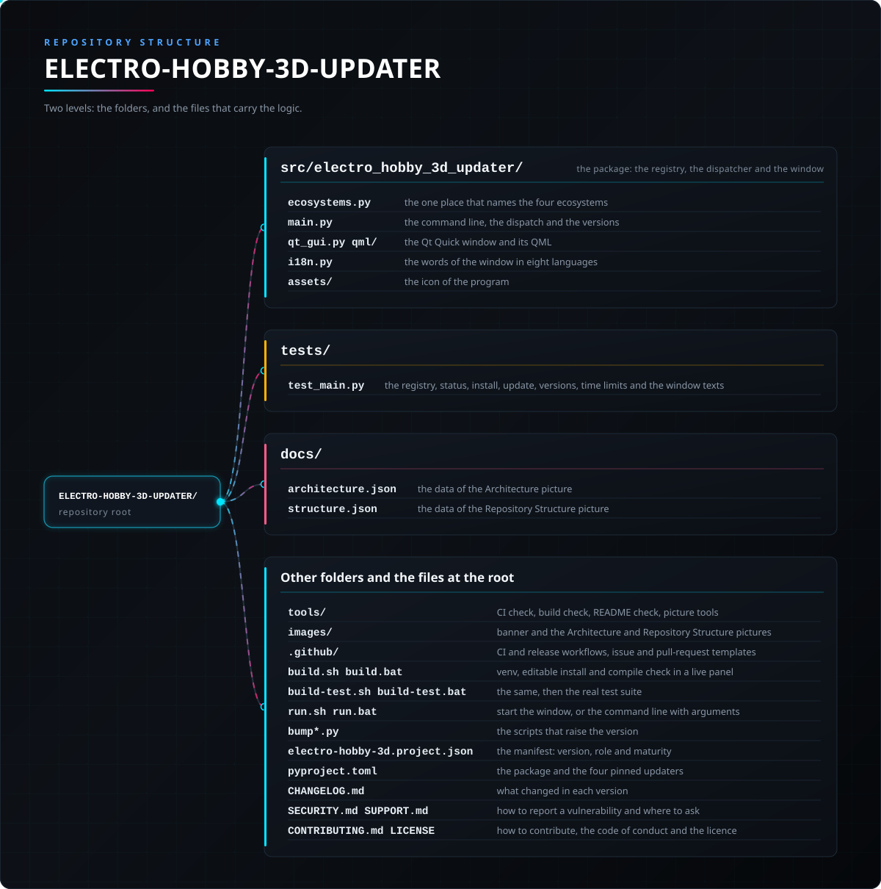

<p align="center">
  
</p>

# 🧩 ELECTRO-HOBBY-3D-UPDATER

<p align="center"><a href="README.md">🇺🇸 English</a> | <a href="README_spa.md">🇪🇸 Español</a> | <a href="README_fra.md">🇫🇷 Français</a> | <a href="README_ita.md">🇮🇹 Italiano</a> | 🇩🇪 <b>Deutsch</b> | <a href="README_zho.md">🇨🇳 中文</a> | <a href="README_jpn.md">🇯🇵 日本語</a> | <a href="README_por.md">🇵🇹 Português</a></p>

### Eine Kommandozeile und ein Fenster für alle vier Electro-Hobby-3D-Ökosysteme: ein System wählen, seine Pakete mit dem Updater herunterladen und aktualisieren, den dieses System schon hat

<p align="center">
  
  
  
  
  
</p>

---

**Ehrlichkeitscheck - was heute tatsächlich läuft:** dies ist ein dünner Dispatcher, keine fünfte Implementierung der Ökosystem-Erkennung: Er enthält keine eigene Logik zum Lesen von Manifesten, zum Installieren oder Aktualisieren. Jedes der vier Ökosysteme hat seinen eigenen Updater, der seine Projekte über das Manifest `<Ökosystem>.project.json` jedes Repositorys findet; dieses Werkzeug installiert die vier als festgelegte Abhängigkeiten und führt den gewählten als eigenen Prozess aus (`status` für alle vier gleichzeitig). Das Weiterreichen und die Befehle, die es baut, sind getestet (18 Tests bestehen, mit einem simulierten Prozess-Runner). `status --ecosystem all` wurde echt gegen einen echten Checkout von drei der Ökosysteme ausgeführt und `install` einmal aus einer sauberen Umgebung (ein Projekt vom A.R.M.O.R.-Updater geklont, gebaut, getestet und übernommen); `update` wurde nicht echt ausgeführt, und die Übergabe an den EH3D-Updater wurde anhand von dessen eigenen Tests ergänzt und über dieses Werkzeug noch nicht gegen einen echten Checkout ausgeführt.

---

> **Stand von Sicherheit und IT-Sicherheit:** es ersetzt Dateien auf deinem Rechner über die Updater, die es ausführt, und tut daher nur, was jeder von ihnen tut, ein Projekt nach dem anderen und nach der Bestätigung, die dieser Updater verlangt. Es führt nichts von selbst aus, aktualisiert nie „alles über die Ökosysteme hinweg“ und steuert keine Maschine. Jeder Updater ist auf einen geprüften Commit festgelegt, nie auf einen beweglichen Branch; unsignierte Revisionen werden mit einer Warnung installiert, außer dieser Updater verlangt Signaturen.

## 📋 Auf einen Blick

| | |
|---|---|
| Version | `0.1.1` |
| Reifegrad | Funktionsfähig |
| Tests | 18 |
| Technologie-Stack | Python 3.10+ (PySide6 for the window) |
| Auf echter Hardware | Nicht zutreffend: Es läuft auf dem PC der Person, die es nutzt |

**Springe zu:** [Überblick](#-überblick) · [Architektur](#-architektur) · [Schnellstart](#-schnellstart) · [Tests](#-tests) · [Struktur](#-struktur-des-repositorys) · [Verwandte](#-verwandte-projekte)

## 🚦 Projektstatus

Jede Zeile ist ein Teil dieses Repositorys, und die Ampel sagt, wie weit er heute ist. Sie beruht auf dem, was das Repository zeigen kann (Tests, Builds, Läufe), nicht auf dem, was geplant ist.

🟢 Fertig und überprüft · 🟡 Funktioniert, mit bekannten Grenzen · 🟠 Teilweise fertig oder noch nicht überprüft · 🔴 Nicht gemacht oder funktioniert nicht

| Bereich | Stand | Was das hier bedeutet |
|---|---|---|
| Software | 🟡 | Ein dünner Dispatcher: Er hat keine eigene Erkennungs-, Installations- oder Aktualisierungslogik und reicht `--ecosystem hydra-umc\|urtc\|armor\|eh3d` an den Updater des jeweiligen Ökosystems weiter, den er als festgelegte Abhängigkeiten installiert. |
| Tests | 🟢 | 18 Tests bestehen (`pytest`) gegen einen simulierten Prozess-Runner; ein weiterer wird übersprungen, wenn PySide6 nicht installiert ist. |
| Echter Einsatz | 🟠 | `status` lief gegen einen echten Checkout von drei der Ökosysteme und `install` einmal aus einer sauberen Umgebung; `update` wurde nicht echt ausgeführt. |
| Fenster | 🟡 | Das Fenster (eine Karte je Ökosystem, ein Protokoll, acht Sprachen) öffnet den eigenen Updater jedes Ökosystems; seine Texte und seine Thread-Regeln sind getestet, der Rest nur von Hand. |
| Integration | 🟠 | Die Übergabe an den EH3D-Updater wurde anhand von dessen eigenen Tests ergänzt und über diesen Dispatcher noch nicht gegen einen echten Checkout ausgeführt. |
| Sicherheit | 🟡 | Jeder Unter-Updater ist auf einen geprüften Commit festgelegt, nie auf einen beweglichen Branch; jeder Lauf ist ein eigener Prozess mit Zeitlimit; unsignierte Revisionen werden mit Warnung installiert, und es gab keine unabhängige Prüfung. |
| Echte Hardware | 🟢 | Nicht zutreffend: Es läuft auf dem PC der Person, die es nutzt. |
| Dokumentation | 🟢 | README in acht Sprachen, bei jeder Änderung gegen Manifest und Änderungsprotokoll geprüft. |

## 🎯 Überblick

* **Ein Werkzeug, vier Ökosysteme:** [HYDRA-UMC](https://github.com/JuanenRac/HYDRA-UMC-UPDATER), [URTC](https://github.com/JuanenRac/URTC-UPDATER), [A.R.M.O.R.](https://github.com/JuanenRac/ARMOR-UPDATER) und [EH3D](https://github.com/JuanenRac/EH3D-UPDATER) haben jeweils ihren eigenen, unabhängig getesteten Updater. Dieses Projekt implementiert nichts davon neu: Es installiert alle vier als Abhängigkeiten und reicht `--ecosystem hydra-umc|urtc|armor|eh3d` an den passenden weiter.
* **Die Erkennung bleibt bei jedem Updater:** Jedes Ökosystem findet seine Projekte über das Manifest jedes Repositorys (`hydra-umc.project.json`, `urtc.project.json`, `armor.project.json`, `eh3d.project.json`); ein neues Repository erscheint also in seinem Ökosystem dadurch, dass es ein Manifest hat, und nichts in diesem Werkzeug listet die Projekte auf. Das eigene Manifest dieses Werkzeugs, `electro-hobby-3d.project.json`, gehört absichtlich zu keinem der vier.
* **Festgelegte, geprüfte Abhängigkeiten:** `pyproject.toml` legt jeden Updater auf einen geprüften Commit fest, nie auf ein bewegliches `main`. `versions` zeigt die installierte Version jedes einzelnen und markiert die, die hinter GitHub zurückliegen.
* **Jedes Mal ein eigener Prozess:** Jeder Aufruf führt `python -m <Modul dieses Ökosystems> --cli ...` als eigenen Interpreter aus; vier argparse-Programme, die jeweils `sys.exit()` aufrufen können, würden sich in einem Prozess gegenseitig stören.
* **`status --ecosystem all`:** führt die vier Statusprüfungen gleichzeitig aus, gibt jeden Bericht vollständig in fester Reihenfolge aus und nennt, welche fehlschlugen, ohne beim ersten aufzuhören.
* **`install` und `update` brauchen immer ein Ökosystem und einen Projektnamen:** Es gibt kein „alles über alle Ökosysteme aktualisieren“, dieselbe Haltung wie bei jedem Updater.
* **Ein Fenster:** Ohne Argumente zeigt ein Qt-Quick-Fenster eine Karte je Ökosystem und ein Protokoll, öffnet den eigenen Updater jedes Ökosystems und fragt ihn nach seinem Status, in acht Sprachen.

## 🧩 Rolle in Electro Hobby 3D

ELECTRO-HOBBY-3D-UPDATER ist das fünfte Stück der Updater-Familie von Electro Hobby 3D und steht über den vier Ökosystemen: Es umhüllt die anderen vier, statt eines zu ersetzen. Es ist der eine Ort, an dem eine Person, die mit mehr als einem Ökosystem arbeitet, alle sehen und das zu aktualisierende wählen kann.

## 🏛️ Architektur

<p align="center">
  
</p>

Wie die Teile dieses Repositorys zusammenpassen: wer es nutzt, was es enthält und wovon es abhängt. Das Bild wird aus `docs/architecture.json` gezeichnet und gegen den Code geprüft.

## 🔒 Sicherheit und Schutz

| Bedrohung | Abwehr |
|---|---|
| Ein bewegliches oder kompromittiertes `main` eines Updaters erreicht dieses Werkzeug | Jeder Updater ist in `pyproject.toml` auf einen geprüften Commit festgelegt, nie auf einen Branch; für einen neueren wird er erst geprüft und die Festlegung hier geändert |
| Ein Updater stört einen anderen | Jeder Aufruf führt den Updater als eigenen Interpreter-Prozess aus (`python -m <Modul> --cli ...`), nie in diesen importiert, sodass keiner Argumente, Zustand oder Beenden eines anderen ändern kann |
| Ein Updater, der hängt (eine Git-Abfrage nach Zugangsdaten, ein totes Netz) | ein Zeitlimit bei jedem Lauf: 900 s für `status` und 1800 s für `install` und `update`, änderbar mit `--timeout-seconds` (0 heißt kein Limit) |
| Eine unerwünschte Massenänderung | `install` und `update` nehmen genau ein Ökosystem und einen Projektnamen und lehnen `--ecosystem all` ab; jeder Updater fragt nach seiner eigenen Bestätigung |
| Den falschen Ordner ansehen | Der Arbeitsbereich wird immer ausdrücklich weitergegeben (standardmäßig der übergeordnete Ordner dieses Werkzeugs), weil ein installierter Updater sonst unter der virtuellen Umgebung dieses Werkzeugs suchen und stillschweigend nichts finden würde |
| Ein Commit unbekannter Herkunft | Sache jedes Updaters: Unsignierte Revisionen werden mit Warnung installiert, außer dem Updater wird gesagt, Signaturen zu verlangen (EH3D-UPDATER und URTC-UPDATER haben diese Option) |
| Der Ausfall eines Ökosystems verdeckt die anderen | `status --ecosystem all` führt alle vier aus, gibt jeden Bericht aus und nennt die fehlgeschlagenen |

**Was nicht abgewehrt wird:** Dieses Werkzeug führt aus, was jeder Updater tut, mit deinen Rechten, einschließlich des Build-Skripts des Projekts, das du installierst; der Updater von A.R.M.O.R. zerstört noch seine eigene Installation, wenn er sich selbst aktualisiert, aktualisiere ARMOR-UPDATER also von Hand; und das Werkzeug wurde nicht unabhängig geprüft. Melde eine Schwachstelle privat (siehe [SECURITY.md](SECURITY.md)).

## 🔌 Schnittstellen

| Schnittstelle | Was es ist | Wo |
|---|---|---|
| Kommandozeile | `electro-hobby-3d-updater` mit `status`, `install`, `update` und `versions`; `--version`; Exit-Codes 0, 1 (ein Lauf schlug fehl oder lief ins Zeitlimit) und 2 (`versions`: ein Updater liegt hinter GitHub) | `main.py` |
| Fenster | Ohne Argumente öffnet sich ein Qt-Quick-Fenster (eine Karte je Ökosystem und ein Protokoll); es braucht das optionale Extra `PySide6` | `qt_gui.py`, `qml/Main.qml` |
| Zu jedem Updater | ein eigener Prozess: `python -m <hydra_umc_updater.main, urtc_updater.main, armor_updater.main oder eh3d_updater.main> --cli <Aktion> [Projekt] --workspace <Ordner>` | `ecosystems.py` |
| GitHub | `versions` liest die `pyproject.toml` des Repositorys jedes Updaters auf `main`, um Versionen zu vergleichen; sonst nichts | `main.py` |

## ⚙️ Konfiguration

Nichts muss konfiguriert werden; die Optionen der Kommandozeile sind die gesamte Konfiguration, alles andere gehört zu den einzelnen Updatern.

| Option | Standard | Bereich | Was sie bewirkt |
|---|---|---|---|
| `--ecosystem` | keine | `hydra-umc`, `urtc`, `armor` oder `eh3d`; `all` nur für `status` | welcher Updater die Arbeit macht |
| `--workspace` | der übergeordnete Ordner dieses Werkzeugs | ein Ordner | der Arbeitsbereich, den jeder Updater durchsucht (immer weitergegeben) |
| `--offline` (`status`, `versions`) | aus | an oder aus | die GitHub-Prüfung überspringen |
| `--timeout-seconds` | 900 für `status`, 1800 für `install` und `update` | eine Zahl von Sekunden; 0 oder weniger heißt kein Limit | einen Updater stoppen, der nicht fertig geworden ist |
| die Festlegungen | vier Commits in `pyproject.toml` | ein geprüfter Commit jedes Updaters | welcher Updater-Code installiert wird; nur nach Prüfung eines neueren geändert |

Die Festlegungen dieser Version sind HYDRA-UMC-UPDATER 0.4.8, URTC-UPDATER 0.1.7, ARMOR-UPDATER 0.1.4 und EH3D-UPDATER 0.0.1.

## 🚀 Schnellstart

Du brauchst Python 3.10 oder neuer; das Fenster braucht zusätzlich PySide6.

```bash
build.bat                                   # ./build.sh on Linux: a venv and an editable install (pulls the four pinned updaters)
pip install -e ".[dev]"                     # the same by hand; add ".[gui]" for the window
python -m pytest tests -q
electro-hobby-3d-updater status --ecosystem all
electro-hobby-3d-updater versions
electro-hobby-3d-updater install --ecosystem urtc URTC-TESTER
electro-hobby-3d-updater update  --ecosystem hydra-umc HYDRA-UMC-SERVER
```

`run.bat` / `run.sh` ohne Argumente öffnen das Fenster. `install` und `update` brauchen ein Ökosystem und einen Projektnamen, so geschrieben, wie das Manifest dieses Ökosystems ihn angibt.

## 🧪 Tests

Die Suite hat 18 Tests, die bestehen (`pytest tests`), und einen weiteren, der übersprungen wird, wenn PySide6 nicht installiert ist. Sie laufen gegen einen simulierten Prozess-Runner, ohne Netz und ohne echten Unterprozess, und decken ab: Die Registry hat genau die vier Ökosysteme; `status` führt das richtige Modul aus und reicht `--offline` weiter; `status --ecosystem all` führt jedes Ökosystem einmal aus, gibt sie der Reihe nach aus, führt sie gleichzeitig aus und hört nie beim ersten Fehler auf; `install` und `update` brauchen ein Ökosystem und ein Projekt und lehnen `all` ab; ein fehlschlagender Updater reicht seinen eigenen Exit-Code weiter; der Arbeitsbereich ist standardmäßig der übergeordnete Ordner; `versions` meldet die installierten Versionen, markiert einen Updater, der zurückliegt, und kontaktiert mit `--offline` nie GitHub; ein hängender Updater wird mit einer klaren Meldung gestoppt, und ein Zeitlimit von null heißt kein Limit; und die Texte des Fensters gibt es in allen acht Sprachen. Die CI führt `python tools/ci_validate.py` (Manifest, Version, Änderungsprotokoll und README-Parität) und danach `python tools/build_test.py` aus, das jede Quelle kompiliert und die Suite ausführt.

## 🏗️ Build und Veröffentlichung

Die Version steht in `pyproject.toml`, in `electro-hobby-3d.project.json` und im Paket, und jede Version hat ihren Eintrag in [CHANGELOG.md](CHANGELOG.md). `build.sh` / `build.bat` legen eine virtuelle Umgebung an, installieren dieses Werkzeug mit seinen vier festgelegten Updatern und prüfen es per Kompilierung; `build-test.sh` / `build-test.bat` tun dasselbe und führen danach die Suite aus; `test.sh` / `test.bat` führen nur die Tests aus, jeweils in einem Live-Panel, und keines ändert die Version. Releases werden auf GitHub veröffentlicht (das neueste ist 0.1.1); das Werkzeug wird aus diesem Repository installiert und liegt nicht auf PyPI.

## 🩺 Fehlerbehebung

| Symptom | Was tun |
|---|---|
| Ein Ökosystem meldet keine Projekte | Der Updater durchsucht den Arbeitsbereich nach Nachbarordnern mit seinem Manifest; gib mit `--workspace` den Ordner an, der die Repositories enthält. |
| `versions` meldet einen Updater als ZURÜCKLIEGEND (Exit-Code 2) | Die Festlegungen sind Absicht: Prüfe den neueren Commit dieses Updaters, trage ihn in `pyproject.toml` ein, erhöhe die Version dieses Werkzeugs und installiere neu. |
| Das Fenster öffnet sich nicht | Es braucht PySide6: `pip install -e ".[gui]"`; die Kommandozeile funktioniert ohne. |
| Ein Updater lief zu lange | Er wurde nach dem Limit gestoppt (900 s für `status`, 1800 s für `install` und `update`); erhöhe es mit `--timeout-seconds`, oder 0 für kein Limit. |
| ARMOR-UPDATER geht nach der Selbstaktualisierung kaputt | Seine editierbare Installation zeigt auf seinen Staging-Ordner: Aktualisiere ARMOR-UPDATER von Hand und führe `build.bat` / `build.sh` erneut aus. |

## 📂 Struktur des Repositorys

<p align="center">
  
</p>

<details>
<summary>Textversion des Baums</summary>

```text
ELECTRO-HOBBY-3D-UPDATER/
├── src/electro_hobby_3d_updater/
│   ├── ecosystems.py                            der eine Ort, der die vier Ökosysteme benennt
│   ├── main.py                                  die Kommandozeile, das Weiterreichen und die Versionen
│   ├── qt_gui.py qml/                           das Qt-Quick-Fenster und sein QML
│   ├── i18n.py                                  die Wörter des Fensters in acht Sprachen
│   └── assets/                                  das Icon des Programms
├── tests/                                       das Weiterreichen gegen einen simulierten Prozess-Runner
├── docs/                                        die Daten der Bilder Architektur und Struktur
├── tools/                                       CI-, Build-, README-Prüfung, Bilder
├── images/                                      Banner und die Bilder von Architektur und Repository-Struktur
├── .github/                                     CI- und Release-Workflows, Vorlagen für Issues und Pull Requests
├── build.sh build.bat                           venv, editierbare Installation und Prüfung in einem Live-Panel
├── build-test.sh build-test.bat                 dasselbe, danach die echte Suite
├── run.sh run.bat                               startet das Fenster, mit Argumenten die Kommandozeile
├── bump*.py                                     die Skripte, die die Version erhöhen
├── electro-hobby-3d.project.json                das Manifest: Version, Rolle und Reifegrad
├── pyproject.toml                               das Paket und die vier festgelegten Updater
├── CHANGELOG.md                                 was sich in jeder Version geändert hat
├── SECURITY.md SUPPORT.md                       Schwachstellen melden und Fragen stellen
└── CONTRIBUTING.md CODE_OF_CONDUCT.md LICENSE   Mitwirken, Verhaltenskodex und Lizenz
```

</details>

## 🗺️ Roadmap und bekannte Grenzen

**Bekannte Grenzen heute**

* `update` wurde nicht echt ausgeführt und `install` nur einmal; `status` lief gegen einen echten Checkout von drei Ökosystemen.
* Die Übergabe an EH3D-UPDATER wurde über dieses Werkzeug nicht gegen einen echten Checkout ausgeführt.
* Es gibt absichtlich kein „alles über die Ökosysteme hinweg aktualisieren“.
* Ob ein Commit signiert sein muss, entscheidet jeder Updater, und der Updater von A.R.M.O.R. zerstört seine eigene Installation, wenn er sich selbst aktualisiert.
* Das Werkzeug wurde nicht unabhängig geprüft und liegt nicht auf PyPI.

**Als Nächstes**

* `status`, `install` und `update` der EH3D-Projekte über dieses Werkzeug an einem echten Checkout ausführen.
* Die Festlegungen auf neuere geprüfte Commits der vier Updater verschieben, sobald diese veröffentlichen.
* `update` an einem Ökosystem echt ausführen und festhalten, was sich zeigt.

## 🌍 Sprachen

README und Texte gibt es auf Englisch, Spanisch, Französisch, Italienisch, Deutsch, Chinesisch, Japanisch und europäischem Portugiesisch.

## 🔗 Verwandte Projekte

Dieses Werkzeug ist das fünfte Stück der Updater-Familie von JuanenRac (Electro Hobby 3D); es umhüllt die anderen vier, statt eines zu ersetzen:

* [HYDRA-UMC-UPDATER](https://github.com/JuanenRac/HYDRA-UMC-UPDATER): erkennt, installiert und aktualisiert die HYDRA-UMC-Repositories
* [URTC-UPDATER](https://github.com/JuanenRac/URTC-UPDATER): erkennt, installiert und aktualisiert die URTC-Repositories
* [ARMOR-UPDATER](https://github.com/JuanenRac/ARMOR-UPDATER): erkennt, installiert und aktualisiert die A.R.M.O.R.-Repositories
* [EH3D-UPDATER](https://github.com/JuanenRac/EH3D-UPDATER): erkennt, installiert und aktualisiert die EH3D-Repositories
* [HYDRA-UMC](https://github.com/JuanenRac/HYDRA-UMC), [URTC](https://github.com/JuanenRac/URTC), [A.R.M.O.R.](https://github.com/JuanenRac/ARMOR-COMMON) und [EH3D](https://github.com/JuanenRac/EH3D-DOCS): die vier Ökosysteme selbst

## 📚 Dokumentation

* [Änderungsprotokoll](CHANGELOG.md): jede Version, was sich änderte und was gefunden wurde.
* [Mitwirken](CONTRIBUTING.md), [Sicherheitsrichtlinie](SECURITY.md) und [Support](SUPPORT.md).
* Die Dokumentation des eigenen Updaters jedes Ökosystems liegt in dessen Repository (siehe Verwandte Projekte).

## 🤝 Mitwirken und Community

* Führe vor einem Pull Request `python -m pytest tests -q` und `python tools/ci_validate.py` aus: Beide müssen bestehen. Siehe [CONTRIBUTING.md](CONTRIBUTING.md) und den [Verhaltenskodex](CODE_OF_CONDUCT.md).
* Das README gibt es in acht Sprachen: Eine Textänderung wird in allen acht Dateien gemacht, und die beiden Bilder werden aus `docs/architecture.json` und `docs/structure.json` mit `tools/make_architecture.py` und `tools/make_structure.py` gezeichnet.
* Dieses Werkzeug muss ein Dispatcher bleiben: Logik, die erkennt, installiert oder aktualisiert, gehört in den Updater des Ökosystems, nicht hierher, und ein neues Ökosystem ist eine Ein-Zeilen-Änderung in `ecosystems.py`.
* Melde eine Schwachstelle privat: [SECURITY.md](SECURITY.md). Fragen, Ideen und Meldungen: electrohobby3d@gmail.com ([SUPPORT.md](SUPPORT.md)).

## 👤 AUTOR

**JuanenRac (Electro Hobby 3D)** · electrohobby3d@gmail.com

## 📜 LIZENZ

Software: GPL-3.0-or-later. Siehe [LICENSE](LICENSE). Die Hardware-Entwürfe der Suite verwenden die CERN OHL-S.
