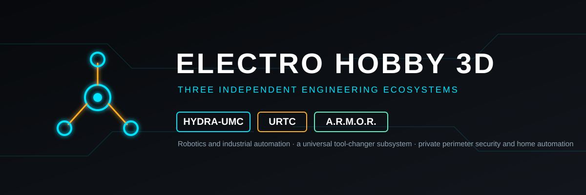

<p align="center">
  
</p>

# 🧩 ELECTRO-HOBBY-3D-UPDATER

<p align="center">
  <a href="README.md">🇺🇸 English</a> |
  <b>🇫🇷 Français</b> |
  <a href="README_spa.md">🇪🇸 Español</a> |
  <a href="README_ita.md">🇮🇹 Italiano</a> |
  <a href="README_deu.md">🇩🇪 Deutsch</a> |
  <a href="README_zho.md">🇨🇳 简体中文</a> |
  <a href="README_jpn.md">🇯🇵 日本語</a> |
  <a href="README_por.md">🇵🇹 Português</a>
</p>

### Une seule ligne de commande pour les trois ecosystemes Electro Hobby 3D - choisissez un systeme, telechargez et mettez a jour ses paquets

<p align="center">
  
  
  
  
  
</p>

---

**Verification d'honnetete - ce qui fonctionne aujourd'hui:** **Maturite : echafaudage.** C'est un dispatcheur mince, pas une quatrieme implementation de la decouverte d'ecosysteme : il ne contient aucune logique propre d'analyse de manifeste, d'installation ou de mise a jour. `dispatch()` et la construction de ses commandes (16 tests, tous contre un executeur de sous-processus simule) sont reels et testes ; `status --ecosystem all` a ete execute pour de vrai contre un checkout reel des trois ecosystemes (55 depots HYDRA-UMC, 7 URTC et 17 A.R.M.O.R. correctement trouves) - `install`/`update` ne l'ont pas encore ete. Un vrai bug a ete trouve et corrige lors de cette premiere execution reelle : voir l'entree `--workspace` dans `CHANGELOG.md`.

---

## 🎯 Apercu

* **Un outil, trois écosystèmes réels :** [HYDRA-UMC](https://github.com/JuanenRac/HYDRA-UMC-UPDATER), [URTC](https://github.com/JuanenRac/URTC-UPDATER) et [A.R.M.O.R.](https://github.com/JuanenRac/ARMOR-UPDATER) ont chacun déjà leur propre outil de mise à jour, testé séparément. Ce projet ne réimplémente rien de cela : il installe les trois comme vraies dépendances et transmet `--ecosystem hydra-umc|urtc|armor` à celui qui correspond.
* **Dépendances épinglées et relues :** `pyproject.toml` épingle chaque sous-outil sur un commit relu, jamais sur un `main` mouvant, donc une installation obtient toujours exactement ce qui a été relu. `versions` affiche la version installée de chacun et signale celui qui est en retard sur GitHub.
* **Un vrai sous-processus séparé à chaque fois.** Chaque appel lance `python -m <module de cet écosystème> --cli ...` dans son propre interpréteur - il n'importe jamais le `main()` d'une autre CLI dans celui-ci. Trois programmes argparse indépendants, chacun libre de lire `sys.argv` et d'appeler `sys.exit()`, se corrompraient dans un même processus.
* **`status --ecosystem all` :** lance en même temps la vérification d'état des trois écosystèmes, affiche chaque rapport en entier dans un ordre fixe et indique lequel ou lesquels ont échoué sans s'arrêter au premier.
* **`install`/`update` exigent toujours un écosystème et un nom de projet.** Il n'y a pas de « tout mettre à jour dans tous les écosystèmes » ici, la même position que la CLI de chaque sous-outil.
* **Limites héritées :** cet outil exécute ce que fait chaque sous-outil. L'outil de mise à jour d'A.R.M.O.R. casse encore sa propre installation quand il se met à jour lui-même (l'installation éditable pointe vers son répertoire de staging) ; mettez donc à jour ARMOR-UPDATER à la main pour l'instant. URTC-UPDATER peut exiger des commits signés (`URTC_UPDATER_REQUIRE_SIGNED=1`) ; les deux autres ne vérifient pas encore les signatures.

## 📂 Structure du Depot

```text
ELECTRO-HOBBY-3D-UPDATER/
├── src/electro_hobby_3d_updater/
│   ├── ecosystems.py   # Le seul endroit qui nomme les trois ecosystemes reels et leur module CLI
│   ├── main.py         # CLI argparse + dispatch() - construit et execute la bonne commande de sous-processus
│   ├── i18n.py         # Les textes de la fenetre dans les huit langues
│   ├── qt_gui.py       # Fenetre Qt Quick (une carte par ecosysteme, un journal) - ouvre l'outil de chaque ecosysteme
│   └── qml/Main.qml    # Le QML de la fenetre
├── tests/               # 16 tests contre un executeur de sous-processus simule
├── tools/               # ci_validate.py, build_test.py, _doc_policy.py, _readme_parity.py
├── build.sh / build.bat         # venv + installation editable (recupere les 3 vraies dependances) + verification de compilation
├── build-test.sh / build-test.bat  # meme installation, puis la vraie suite pytest
└── run.sh / run.bat              # point d'entree de la CLI (sans argument : la fenetre)
```

## 🛠️ Environnement de Developpement

```bash
pip install -e ".[dev]"                 # installe aussi hydra-umc-updater, urtc-updater et armor-updater depuis GitHub
python -m pytest tests -q               # 16 tests, sans reseau ni vrai sous-processus
electro-hobby-3d-updater status --ecosystem all               # verifie tous les ecosystemes (en parallele)
electro-hobby-3d-updater versions                             # version installee de chaque outil et s'il est en retard sur GitHub
electro-hobby-3d-updater status --ecosystem armor             # verifie un seul
electro-hobby-3d-updater install --ecosystem urtc URTC-TESTER # clone et construit un projet pas encore installe
electro-hobby-3d-updater update  --ecosystem hydra-umc HYDRA-UMC-SERVER # met a jour et reconstruit un projet deja installe
```

## 🔗 Projets Lies

Cet outil est la quatrieme piece de la propre famille d'updaters de JuanenRac (Electro Hobby 3D) - il enveloppe les trois autres au lieu d'en remplacer un :

* **[HYDRA-UMC-UPDATER](https://github.com/JuanenRac/HYDRA-UMC-UPDATER)** - detecte, installe et met a jour les propres depots de l'ecosysteme HYDRA-UMC
* **[URTC-UPDATER](https://github.com/JuanenRac/URTC-UPDATER)** - detecte, installe et met a jour les propres depots de l'ecosysteme URTC
* **[ARMOR-UPDATER](https://github.com/JuanenRac/ARMOR-UPDATER)** - detecte, installe et met a jour les propres depots de l'ecosysteme A.R.M.O.R.
* **ELECTRO-HOBBY-3D-UPDATER** (ce depot) - redirige vers celui des trois que l'utilisateur choisit

Et les trois ecosystemes reels eux-memes : **[HYDRA-UMC](https://github.com/JuanenRac/HYDRA-UMC)** (controle industriel multi-robots), **[URTC](https://github.com/JuanenRac/URTC)** (la plateforme Universal Robot Tool Controller), **[A.R.M.O.R.](https://github.com/JuanenRac/ARMOR-COMMON)** (securite perimetrique et domotique).

## 📚 Documentation et Communaute

* **[Historique des modifications de ce depot](CHANGELOG.md)**
* Questions, idees et rapports: electrohobby3d@gmail.com

## 👤 AUTEUR

**JuanenRac (Electro Hobby 3D)** · electrohobby3d@gmail.com

## 📜 LICENCE

GPL-3.0-or-later - voir [LICENSE](LICENSE).
